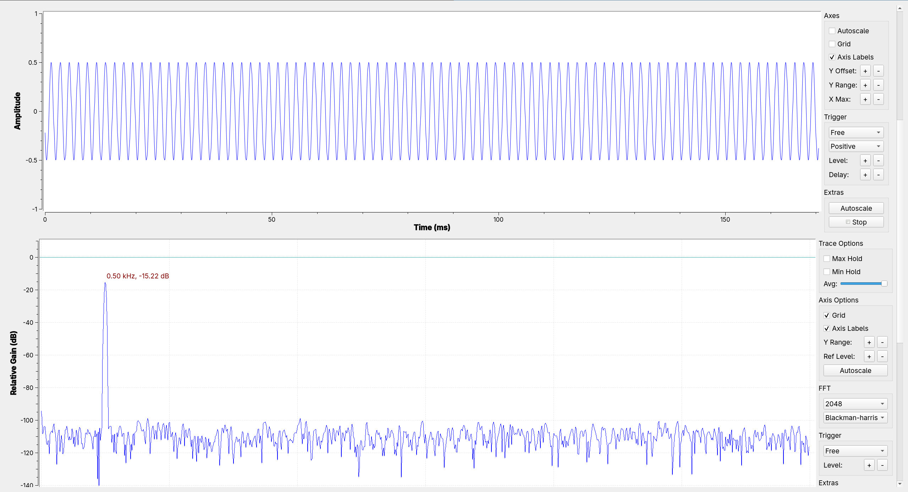
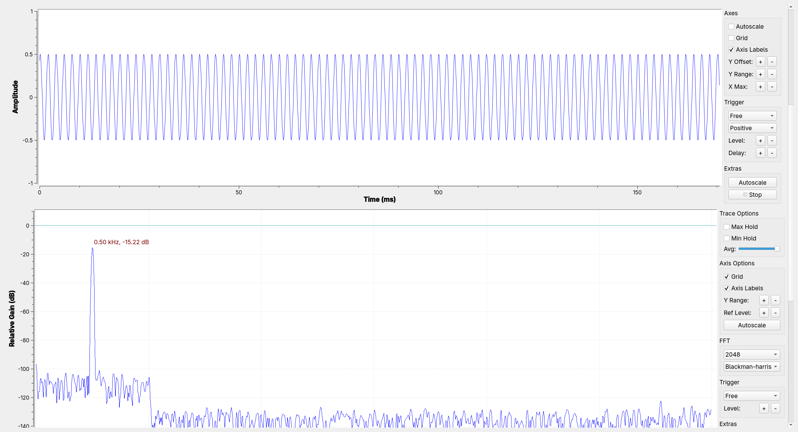
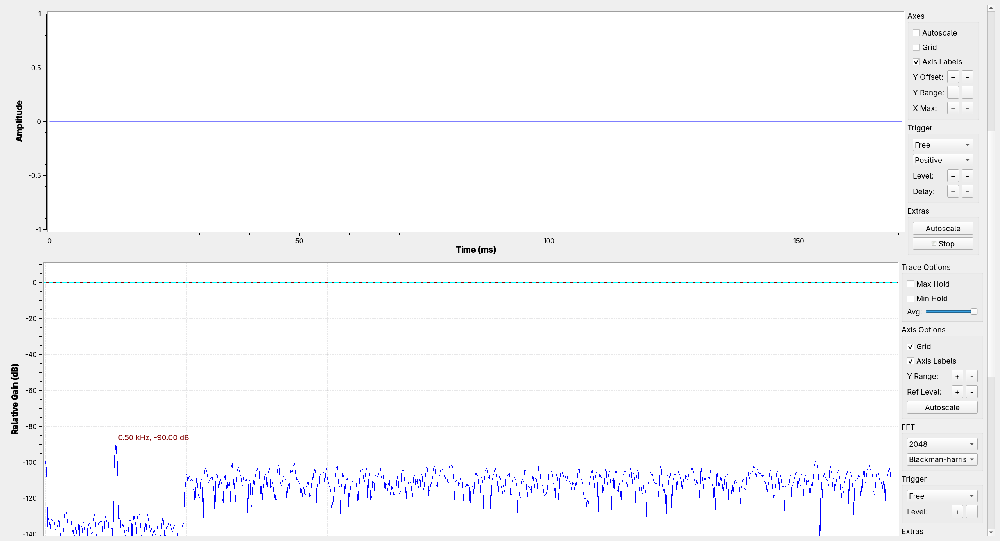
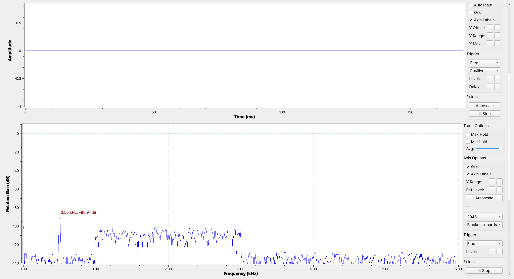
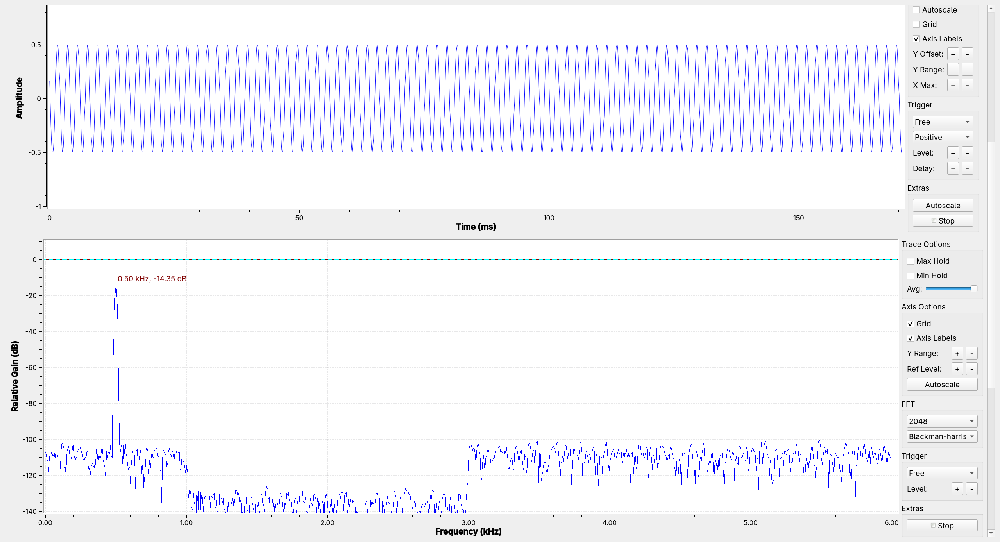

## Overview
Implementation of 4 FIR filters and 1 IIR filter for audio processing on a
`STM32H7B3I-DK` board. Signal is sampled using the line-in (blue) port by an
on-board `CS32L51` audio codec, processed, then sent to both the line-out
(green) port and PC (through UART interface). Processed signal can then be
visualized using a Python script and GNU Radio software.

The following FIR filters are implemented: low pass (< 1kHz), high pass (>
1kHz), band pass (> 1kHz, < 3kHz), band stop (< 1kHz, > 3kHz). Low pass filter
is also implemented as an IIR filter. Filters are switched at runtime using an
on-board USER button (FIR/IIR mode is still defined at compile-time).

Multiple implementation variants are present: using CMSIS-DSP library/custom
implementation, using FLOAT64/INT16, with/without loop unrolling (in CMSIS-DSP).
Implementation is selected by applying preprocessing directives during
compilation.

Filter generation parameters and characteristics are available in MatLab source
files under `matlab/` directory.

Measurement results with different implementation variants are available in
`info/measurements.txt` file.

## Build and run
### Requirements
```
arm-none-eabi GCC cross compiler
GNU/make
STM32CubeMX (optional, for code generation from template)
stm32-for-vscode Code - OOS extension (optional, for easier build and flash)
```

### Build
Important note: `Makefile` in the project root was generated by STM32CubeMX, do
not use it for building. Use `STM32Make.make` insted.

```
git clone https://github.com/mon1t0r/stm32-filters
cd stm32-filters

make DEBUG=0 -f STM32Make.make clean
make DEBUG=0 -f STM32Make.make
```

### Run
After microcontroller is connected to the PC and is running the flashed
program, start GNU Radio, open `gnuradio/analysis.grc` and run the
configuration. Then, in another terminal window, run
`python gnuradio/udp_bridge.py` to start reading serial port and sending data
to the GNU Radio software. You should now see an amplitude graph and a Fourier
transform graph for each channel (4 graphs in total).

## Screenshots
Below are screenshots of GNU Radio software, different FIR filters are tested.







